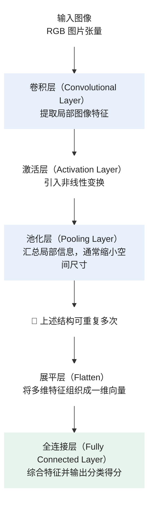
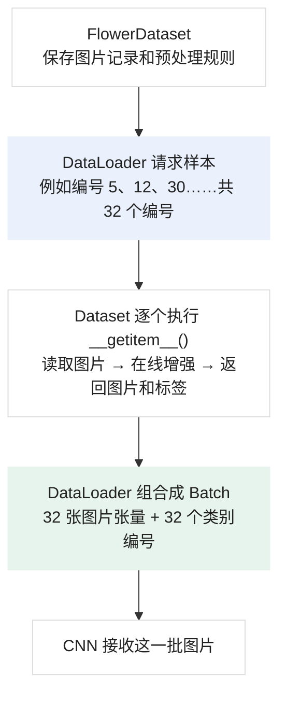

- 本题学习大部分由**ChatGPT 辅助完成**，另外还观看了观看**B 站、Youtube 的相关视频**。
- ChatGPT 对话链接：
- 笔记绝大部分均为**小登古法制作**，**除Markdown公式和图片外**，无任何复制粘贴。


# 花卉小能手
## Conda 环境
- **虚拟环境：** 一个相对独立的软件运行环境，可以让不同项目使用不同版本的 Python 库，避免相互干扰。
- **Conda**是一种环境与软件包管理工具。
    - **Miniconda**：Conda 的精简发行版。需要额外的软件包时，自己安装。
    - **Anaconda**：完整版。预装大量常见的数据分析、科学计算、机器学习相关软件包，减少首次配置工作。
        - 还包含 Anaconda Navigator，一种可以通过图形界面管理环境和软件包的程序，Miniconda 默认没有它，通常使用终端命令管理。
- Conda vs venv：
<div align="center">
<table>
  <tr>
    <th align="center">对比</th>
    <th align="center">venv</th>
    <th align="center">Conda</th>
  </tr>
  <tr>
    <td align="center">创建独立的 Python 环境</td>
    <td align="center">✓</td>
    <td align="center">✓</td>
  </tr>
  <tr>
    <td align="center">管理 Python 库</td>
    <td align="center">通常配合 pip</td>
    <td align="center">可以使用 Conda，也可配合 pip</td>
  </tr>
  <tr>
    <td align="center">管理 Python 解释器版本</td>
    <td align="center">使用已有的 Python</td>
    <td align="center">可在环境中安装指定版本的 Python</td>
  </tr>
  <tr>
    <td align="center">管理非 Python 依赖</td>
    <td align="center">能力有限</td>
    <td align="center">可以管理</td>
  </tr>
</table>
</div>

- **Python 解释器**：负责执行 Python 代码的程序。
- **Pytorch**：一个用于机器学习和深度学习的软件框架。
    - **框架**：一套已经设计好的功能体系，帮助我们完成模型构建、数学运算、训练等任务。
- CPU vs GPU
    - **CPU（中央处理器）**：计算机的通用件算设备，可执行 Python 程序及神经网络运算。
    - **GPU（图形处理器）**：擅长同时进行大量数值计算，因此通常可以加速神经训练。
- **SHA-256**是一种哈希算法。
    - 它能够根据文件内容计算出一个固定长度的值，称为**哈希值**。
- **Torchxision**：是Pytorch 生态中专门用于计算机视觉的软件库。
  - **计算机视觉**：就是让计算机处理和分析图片、视频等视觉信息的技术。
- **torch**：是一个提供数学计算、神经网络构建、自动求导以及模型训练所需要的基础工具的软件包。
- **CUDA**：是 NVIDIA提供的并行计算平台及编译技术。

## 初识 CNN
### 概念
- **属性（Attribute）**：对象所具有的信息。
- **方法（Method）**：与对象关联、可以调用的函数。
#### 计算机表示彩色图片
- **像素（Pixel）**：数字图像的基本组成单位。
    - 一张数字图像可以表示成规则排列的像素。
- **RGB颜色模型**：
    - Red、Green、Blue
    - 一张普通 RGB 彩色图片中，每个像素使用 **三个数值** 表示颜色： $(R, G, B)$
     - **每个颜色分量用 8 个二进制位存储** ，每个分量通常可以取整数 0 ~ 255。
    - 数值越大，颜色越明显，分量为 0 表示黑色。
     - **颜色通道**：图像某一种颜色分量所对应的数值信息。
     - 一张宽度为 $W$、高度为 $H$ 的 RGB 图片，每个颜色通道都可以表示为一个 $H\times W$ 的二维数值矩阵。
    - PyTorch中一张 RGB 彩色图片可以表示为形状为 $(3, H, W)$ 的张量。
        - 例：`array[0][H - 1][W - 1] = 123`就表示 R 通道在第 $H$ 行，第 $W$ 个像素的数值为 123。
- **张量**：在机器学习中，张量是 **一种表示多维数值数组的数据结构**。
    - 本质是多维数组，便于索引多维数据。
    - **维度数量**：一个标量，表示需要几个下标定位元素。
        - **轴**：张量的特定维度。
            - **轴的长度**：在某个特定维度定位所有元素需要的整数个数。
    - **形状**：一个数组，衡量每个维度的长度。
    - **元素数量**：表示张量有多少个元素。
        - 数值上等于各轴的长度的积。
- **数值缩放（Rescaling）**：把 0 ~ 255 缩放为 0 ~ 1。
    - 例子：$\left(\frac{128}{255},\frac{64}{255},1\right)\approx(0.502,0.251,1)$
    - 通常有助于控制输入的数值尺度，使神经网络的计算与优化过程更加稳定。
    - 并不是所有模型都必须使用 0～1 范围，还要根据模型的预处理要求决定。
    - 写法：`tensor = tensor / 255`
- **有损压缩（Lossy Compression）**：为了减小文件体积，允许丢弃一部分图像信息，因此解压得到的像素值可能与压缩前不完全相同。
    - JPG 采用有损压缩保存图片。
- **无损压缩（Lossless Compression）**：解压后可以准确恢复原始像素数据。
    - PNG 采用有损压缩保存图片。
- **解码（Decoding）**：解码是指根据图像文件格式的规则，将保存的数据还原为计算机能够处理的像素信息。
#### 读取真实图片并转换为 PyTorch 张量
- **Pillow**：Python 中常用的图像处理软件库。
    - Python 名称：PIL
    - Image：提供图片读取、创建和操作等功能的模块。
- **transforms**：Torchvision 提供的图像变换模块。
#### 卷积神经网络
- **CNN（Convolutional Neural Network，卷积神经网络）**：一种特别适合处理图像等具有空间结构的数据的神经网络。




- CNN 没有固定的层数，也不是必须包含上图中的所有层。
- **卷积层**：用一个较小的计算窗口，在图片的 **不同位置** 进行加权、引入偏置计算，从而提取 **局部特征**（花瓣的边缘、花瓣上的条纹、不同颜色的交界处等）。
    - **特征图（Feature Map）**：记录某些图像特征在不同空间位置上的响应数值的数组。
        - 卷积层通常的输出结果。
    - **有几个输入通道，每计算一次输入数据就有几个权重矩阵**
        - 在每个输入通道的相同区域计算卷积后，将这些结果加起来，引入偏置，就得到了某一个输出通道的一个位置上的数据。
        - 计算一次所有输入通道所需的的权重矩阵合起来称为一组 **卷积滤波器（Filter）**。
    - **有几个输出通道，就有几组滤波器。**
- **激活层**：引入非线性，使神经网络能够表示更加复杂的函数关系。
- **池化层**：
    - **池化（Pooling）**：一种对局部区域的数据进行汇总的操作。
        - 常用于减小特征图的空间尺寸，减少后续计算量。
- **展平层**：展平层的作用，是在不改变数值本身的情况下，将多维特征重新组织为一维向量，以便输入传统的全连接分类层
    - **展平（Flatten）**：将 **多维数据** 重新排列成 **一维向量**。
        - 它只改变数据的组织方式，不会学习新的模型参数。
        - 对于一般的三维张量 $(C, H, W)$ 展平后的向量长度为 $L = C\times H\times W$
        - **具体操作**：每一个通道按照顺序把每一行拼接起来，然后再按顺序把每一个通道的数据依次拼接起来
- **全连接层**：前面提取到的图像特征转化为各类别的预测得分。
    - 类似 MLP 的一层隐藏层。
    - **Dense Layer（稠密层）**通常就是 **Fully Connected Layer（全连接层，简称 FC）** 。
- **其他常见层**：
    - **批归一化层（Batch Normalization，BN）**：对神经网络中间数据进行 **归一化**等数值调整的网络层，目的是帮助训练更加稳定。
    - **Dropout 层**：训练时随机将一部分神经元的输出设置为零，以减轻模型对个别神经元的过度依赖。
    - **填充层（Padding）**：输入数据的边缘添加额外数值，最常见的是补零。
        - **填充（Padding）**：控制卷积后的空间尺寸，并使卷积核能够覆盖靠近原图边缘的位置，也能辅助满足要求的输出尺寸。
            - Padding 可以作为单独的层，也可以直接作为卷积层的参数，并不一定需要专门创建一个层。
- **卷积核（Kernel）**：一个较小的数值数组，CNN 用它对输入图片的局部区域进行加权计算。
    - **卷积核的权重(Weight)**：这个数组的数值。
- **卷积**：以卷积核为计算窗口，在输入图像上滑动并进行加权计算的操作。
    - 数学上进行卷积运算要先将**卷积核的各个维度翻转**（对于，再进行局部加权运算。
        - CNN 常用的不翻转运算，数学上称为互相关 **（Cross-Correlation）**。因此严格来讲，**CNN真正使用的是数学上的互相关**。
            - 但是由于**卷积核的权重是可学习的**，因此**不翻转核通常不会影响网络学习这类局部线性加权运算**。这也是 CNN 使用互相关，但仍然沿用“卷积”这一名称的主要原因。
- **离散（Discrete）**：指数据只在一个个分开的、指定的位置上取值，而不是在连续的所有位置上取值。
- **步长（Stride）**：计算窗口在图片上移动时，每次移动的像素个数。
    - **步长越大，卷积核访问的位置通常越少，输出的空间尺寸也越小。**
    - 假设图片高度是 $H$，正方形卷积核的边长是 $K$ ，步长是 $S$ 。
        - 输出高度为：$H_{\mathrm{out}} = \left\lfloor \frac{H-K}{S} \right\rfloor + 1$
- **池化（Pooling）**：把特征图划分为局部区域，对每个区域的数值进行汇总，用较少的数值表示原来的局部信息。
    - 池化的一般作用：
        - **减少特征图的空间尺寸，减少后续卷积层的计算量**。
        - **保留局部区域的代表性信息**。
        - **降低模型对某些微小位置变化的敏感性，防止过拟合**。
    - 常见的池化操作不会通过训练学习权重，而是 **采用预先规定的计算规则** 。
    - 类型：
        - **最大池化（Max Pooling）**：对于每个局部区域，取其中的最大值作为输出。
            - 作用：**减小计算量、保留区域内最强的特征响应、减少细节和噪音等对模型的影响，抑制过拟合等**。
        - **平均池化（Average Pooling）**：对局部区域内的所有数值求算术平均值，将平均值作为输出。
            - 作用：**汇总整体特征信息、使区域的特征更“平滑”、把某个区域的特征浓缩到一个值，降低过拟合风险等等**。
        - **自适应池化（Adaptive Pooling）**人为指定池化后空间尺寸的大小，模型根据输入和输出目标尺寸，自动确定如何划分池化区域。
            - 作用：**便于控制输出尺寸**。
            - 实践中常结合最大池化和平均池化使用。
        - **全局平均池化（Global Average Pooling）**：平均池化的一种，对每个输入通道的整个空间区域取平均
            - 作用：**大幅减少后续计算量、汇总整张特征图、降低过拟合风险等**
        - **全局最大池化（Global Max Pooling）**：最大池化的一种，对每个输入通道的整个空间区域取最大值。
            - 作用：**大幅减少后续计算量、保留整张特征图的最强特征、降低过拟合风险等**
- **感受野（Receptive Field）**：某一层特征图上某个位置的感受野，是输入图像中能够影响该位置输出数值的空间区域，也就是得出这个位置时，计算窗口覆盖的区域。
    - 堆叠卷积层可以扩大感受野。
- **Logits**：CNN 输出各类别的得分，这种尚未转化为概率的原始分类得分，通常称为 **Logits**。
- **将得分转化为概率的方法**：通过 Softmax 函数将得分转化为概率。
- **得到预测类别**：**Argmax**操作。
    - Softmax 不改变各类别得分的大小顺序，也就是说，只需要得到预测类别时，可以直接对 Logits 使用 Argmax，无需先计算 Softmax。

#### 异常隔离
- **pathlib**：Python 标准库中用于处理文件路径的工具模块。
- **Path**：用来表示文件或文件夹路径的类。
- **隔离（Quarantine）**把异常文件从正常数据集中移出去，单独保存。
- **shutil**：Python 标准库中提供文件和文件夹操作功能的模块。
#### 数据划分
- 文件夹在磁盘上的 **枚举顺序** ，并不保证是 **名称顺序** 。
- **不同操作环境下，文件系统返回的项目顺序不一定相同。**
- **为什么先 .sort() 再 .shuffle()？**
    - 我们希望每次随机打乱之前，图片列表具有固定的初始顺序。这样 **配合固定随机种子，就可以重复得到相同的结果**。
- **为什么分别对每个 category 操作？**
    - 实现分层划分。
- **CSV（Comma-Separated Values）**：是一种以文本形式存储表格数据的文件格式，通常使用逗号分隔每一列。
    - 图片本身不移动、不复制。 后续训练 CNN 时，根据对应清单读取图片即可。 **这是一种便于复现实验的数据集划分方式。**
- **字符编码（Character Encoding）**：把字符转换为字节保存，以及把字节重新解释成字符的规则。
    - UTF-8 是一种常用的文本编码格式。

#### 数据预处理
- **数据增强**：通过对原始训练样本施加适当的变换，生成新的训练样本，从而增加训练数据的多样性。
    - **种类**：
        - **离线数据增强**：提前生成新图片并保存到磁盘，图片文件数量确实增加。
        - **在线数据增强**：训练时临时对图片进行随机变换，不额外保存文件，但模型可以在不同训练轮次看到不同版本的图片。
    - **只能对训练集进行数据增强**，因为验证集、测试集的作用是 **评估模型** ，不应该为了扩充训练样本而把它们加入训练集，也不应该让评估结果依赖随机增强。
    - **必须先划分数据集，再生成增强图片。**

<div align="center">
<table>
  <tr>
    <th align="center">方法</th>
    <th align="center">操作</th>
    <th align="center">对花卉识别的作用</th>
  </tr>
  <tr>
    <td align="center">水平翻转</td>
    <td align="center">将图片左右镜像</td>
    <td align="center">减少模型对花朵朝向的依赖</td>
  </tr>
  <tr>
    <td align="center">随机旋转</td>
    <td align="center">将图片旋转一定角度</td>
    <td align="center">增加拍摄角度的多样性</td>
  </tr>
  <tr>
    <td align="center">亮度调整</td>
    <td align="center">让图片变亮或变暗</td>
    <td align="center">适应不同光照条件</td>
  </tr>
  <tr>
    <td align="center">随机裁剪</td>
    <td align="center">截取图片中的部分区域</td>
    <td align="center">增加构图多样性，但可能裁掉花朵</td>
  </tr>
  <tr>
    <td align="center">颜色扰动</td>
    <td align="center">轻微改变颜色、对比度等</td>
    <td align="center">提升对拍摄条件变化的适应能力</td>
  </tr>
</table>
</div>

- **图片尺寸调整**：让图片符合 CNN 的输入要求。
- **插值（Interpolation）**：根据已知位置上的数值，估计新位置所需要的数值。
    - **双线性插值（Bilinear Interpolation）**：利用新位置周围的像素值进行加权计算。

- **图片尺寸调整**：让图片符合 CNN 的输入要求。
    - **插值（Interpolation）**：根据已知位置上的数值，估计新位置所需要的数值。
        - **双线性插值（Bilinear Interpolation）**：利用新位置周围的像素值进行加权计算。
    - **调整尺寸不只是修改数组的形状，还需要重新计算新图片的像素值**。
- **transforms**：Torchvision 中用于图像变换的模块。

#### 炼丹
- **超参数（Hyperparameters）**人工为模型结构或训练过程预先指定的配置，它们通常不会像权重和偏置一样，通过普通的梯度下降直接学习得到。
- **参数 vs 超参数**：

<div align="center">
<table>
  <tr>
    <th align="center">比较</th>
    <th align="center">模型参数</th>
    <th align="center">超参数</th>
  </tr>
  <tr>
    <td align="center">作用</td>
    <td align="center">决定模型具体如何计算</td>
    <td align="center">决定模型结构或如何训练</td>
  </tr>
  <tr>
    <td align="center">典型例子</td>
    <td align="center">权重、偏置</td>
    <td align="center">学习率、Batch Size、卷积核尺寸</td>
  </tr>
  <tr>
    <td align="center">如何确定</td>
    <td align="center">通常由训练算法学习</td>
    <td align="center">由人为设定或自动调参方法选择</td>
  </tr>
  <tr>
    <td align="center">是否通过普通梯度下降直接更新</td>
    <td align="center">是</td>
    <td align="center">通常不是</td>
  </tr>
</table>
</div>

- **CNN 重要超参数**：

<div align="center">
<table>
  <tr>
    <th align="center">超参数</th>
    <th align="center">含义</th>
    <th align="center">主要影响</th>
  </tr>
  <tr>
    <td align="center">学习率（Learning Rate）</td>
    <td align="center">每次沿梯度方向更新参数的步幅系数</td>
    <td align="center">训练速度与稳定性</td>
  </tr>
  <tr>
    <td align="center">批次大小（Batch Size）</td>
    <td align="center">一次用于计算和更新参数的样本数量</td>
    <td align="center">内存占用、梯度估计、训练效率</td>
  </tr>
  <tr>
    <td align="center">训练轮数（Epochs）</td>
    <td align="center">训练数据被完整遍历的次数</td>
    <td align="center">训练程度与过拟合风险</td>
  </tr>
  <tr>
    <td align="center">卷积核尺寸（Kernel Size）</td>
    <td align="center">卷积核的空间大小</td>
    <td align="center">局部特征的提取范围</td>
  </tr>
  <tr>
    <td align="center">卷积层输出通道数</td>
    <td align="center">每层生成多少张特征图</td>
    <td align="center">网络表示能力、参数量和计算量</td>
  </tr>
  <tr>
    <td align="center">Dropout 概率</td>
    <td align="center">训练时随机失活输出的概率</td>
    <td align="center">正则化强度</td>
  </tr>
</table>
</div>

- **优化器类型及作用**：
    - **小批量随机梯度下降（Mini-batch SGD）**：计算一小批训练数据的平均梯度，然后进行梯度下降。
            - SGD 是随机梯度下降，意为随机抽取训练样本估计梯度，但由于一次使用一个样本，更新频繁，且波动较大
            - **在Pytorch 中，称小批量梯度下降为 SGD**。
    - **动量法（Momentum）**：利用历史梯度信息，使参数持续向某方向更新时更新加快，在参数收敛时加快收敛。
    - **自适应梯度算法（AdaGrad）（Adaptive Gradient）**：根据训练过程中观察到的梯度，自动调整不同参数的有效学习率。

        $$
        G_t = \sum_{k=1}^{t} g_k^2
        $$

        $$
        w_{t+1} = w_t - \frac{\eta}{\sqrt{G_t}+\varepsilon}g_t
        $$

        - $G_t$：截至当前的历史梯度平方和。
        - $varepsilon$：防止分母为零的一个很小的正数。
        - $g_t$：当前梯度。
        - **主要局限： 梯度平方和会不断累积，可能使有效学习率越来越小，最终更新过慢**。
    - **改进自适应学习率(RMSprop)(Root Mean Square Propagation)**：
        - $s_t$：当前的梯度平方统计量。
        - $\rho$：控制历史信息保留程度的系数，通常在 0～1 之间。
        - 主要作用： 根据近期梯度大小自动调整不同参数的更新幅度，减轻 AdaGrad 有效学习率持续减小的问题。
    - **结合动量与自适应学习率(Adam)(Adaptive Moment Estimation)**：利用过去的梯度方向和梯度平方大小，调整梯度的大小和有效学习率（实际上可以认为只调整了梯度）从而加快参数更新、收敛。
- **Dataset（数据集对象）**：一个 **按照编号读取样本（图片、标签），并对样本预处理（放缩尺寸、数据增强等）** 的对象。
- **DataLoader（数据加载器）**：一个 **从 Dataset 中取得样本，将它们按照 Batch 大小组织成批次，并且可以控制样本读取顺序的工具** 的工具。
    - **可控制是否“随机打乱读取顺序”**。
    - **PyTorch 提供的一个类。**
- **类(class)**：定义某一类对象具有哪些数据，以及能够执行哪些操作的模板。
    - **实例(instance)**：根据类创建出的具体对象。

    ```python
    class Student:
        def __init__(self, name):
            self.name = name
    ```
    - **例子讲解**：
        - `class` Python 用于定义类的关键字。
        - `Student`我们给这个类起的名字。
        - `__init__()` Python 中的特殊方法，用于初始化新创建的实例。
            - 在实例创建过程中被自动调用。会创建一个`类的名字`实例，并通过`__init__()`设置它的初始数据。
        - `self`表示当前正在操作的实例对象。
            - `self.name`表示将名称保存到当前实例中。
            - `.name`等类似的代码是我们自己定义的实例属性。不是`Path.name`这种属性。
    - **继承（Inheritance）**：Python 类之间的一种关系：一个新类可以在另一个类提供的基础上定义自己的行为。
        - 基本写法：
        ```python
        class 子类名称(父类名称):
            ...
        ```
        - PyTorch 已经提供了`from torch.utils.data import Dataset`，我们可以写`class FlowerDataset(Dataset):`
            - 意为定义一个新的 FlowerDataset 类，它继承 PyTorch 的 Dataset。
            - 可以 **让我们的花卉数据集符合 PyTorch 的数据读取接口要求，便于之后交给 DataLoader 使用** 。
    - 对于当前这种 **按照整数编号获取样本的数据集** ，我们主要需要定义三个方法。

    <div align="center">
    <table>
    <tr>
        <th align="center">方法</th>
        <th align="center">什么时候调用</th>
        <th align="center">作用</th>
    </tr>
    <tr>
      <td align="center"><code>__init__()</code></td>
      <td align="center">创建实例时</td>
      <td align="center">保存 CSV 记录和预处理规则</td>
    </tr>
    <tr>
      <td align="center"><code>__len__()</code></td>
      <td align="center">使用 <code>len(dataset)</code> 时</td>
      <td align="center">返回样本总数</td>
    </tr>
    <tr>
      <td align="center"><code>__getitem__()</code></td>
      <td align="center">使用 <code>dataset[index]</code> 时</td>
      <td align="center">返回指定编号的样本</td>
    </tr>
    </table>
    </div>

- **Dataset 代码与解释**
    ```python
    import csv

    from PIL import Image
    from torch.utils.data import Dataset


    class FlowerDataset(Dataset):

            def __init__(self, csv_path, transform):
                with open(csv_path, "r", encoding="utf-8", newline="") as file:
                    self.rows = list(csv.DictReader(file))

                self.transform = transform

                self.label_to_id = {
                    "daisy": 0,
                    "dandelion": 1,
                    "rose": 2,
                    "sunflower": 3,
                    "tulip": 4
                }

            def __len__(self):
                return len(self.rows)

            def __getitem__(self, index):
                row = self.rows[index]

                with Image.open(row["path"]) as image:
                    image = image.convert("RGB")
                    image_tensor = self.transform(image)

                label = self.label_to_id[row["label"]]

                return image_tensor, label
    ```

    - 我们通常直接使用`len(dataset)` 求得数据集的长度，Python 会使用对象的特殊方法 __len__() 来完成操作。
        - 从 Python 的内部机制来说，类中使用 def 创建的通常是 **函数对象** ；它 **通过实例被访问时，会形成绑定方法** 。因此“类中定义的方法”和“普通函数”在概念上相关，但调用行为有区别。
    - 一个属性可以保存一个函数，或者一个能够像函数一样被调用的对象。
        - 此时实例函数会引用右边函数名关联的函数对象。
- **Dataset 和 DataLoader 如何协作？**



- **Dataloader 代码与解释**:

    ```python
    train_loader = DataLoader(
        train_dataset,
        batch_size=32,
        shuffle=True
    )
    ```
    - **训练时随机打乱读取顺序**：
        - **减少样本原有排列顺序的影响** ，特别是数据按类别或拍摄来源排列的情况。
        - **让连续 Batch 的数据更加多样化** ，减少连续多个 Batch 高度相似的情况。
        - **改变不同 Epoch 的样本组合** ，使参数更新不总是遵循相同的批次顺序。
    - **评估时不随机打乱顺序**：
        - 无数据增强时不影响评估准确率。
        - 让每次评估时的样本读取顺序一致，方便调试。
        - 方便将预测结果与原始 CSV 中的图片路径逐项对应。
        - 避免无意义的随机性，使实验流程更容易复现。
- **定义卷积层**：

    ```python
    self.conv1 = nn.Conv2d(
    in_channels=3,
    out_channels=96,
    kernel_size=11,
    stride=4,
    padding=2
    )
    ```

    - `in_channels`输入通道数 3
    - `out_channel`输出通道数 96
    - `kernel_size`卷积核尺寸 11×11
    - `stride`步长 4
    - `padding`每侧填充宽度 2
- **CNN构建**：
    - `nn.Module`是 PyTorch 中构建神经网络模型的基础类，为模型提供管理子层、参数、训练状态等功能。
    - `super().__init__()`会执行 nn.Module 的初始化逻辑，建立 PyTorch 管理模型所需要的内部结构。
        - **我们应该在注册卷积层等子模块之前，先执行父类初始化。**
    - 在 `nn.Module` 已经正确初始化的前提下，将子模块赋给 `self.conv1` 这样的实例属性，PyTorch 会自动注册该子模块。
        - **注册（Registration）**：让 PyTorch 知道这个属性属于当前模型。
            - 注册后，它 **包含的权重和偏置就能够被模型统一管理。这对后续优化器更新参数、切换设备和保存模型很重要** 。
    - 如果只用一种激活函数、最大池化那么只需要创建一个`self.relu`、`self.poll`。因为普通 ReLU\最大池化 不包含可学习参数。每次调用同一个 ReLU\poll 对象，它都会执行相同的逐元素运算。
    - `torch.flatten(x, start_dim=1)``nn.Flatten(start_dim=1)`
        - 前者为 Torch 展平函数，后者为可以保存在模型中的 PyTorch 展平模块。
        - 张量形状为`(Batch, 通道数， 高度， 宽度)``start_dim=1`意为把一个批次中每一个样本展平，不能从 Batch 维度开始。
            - `start_dim`默认为 1。
- **损失函数与优化**：
    - **交叉熵损失（Cross-Entropy Loss）**
        - $L_i = -\ln(p_{i,y_i})$
            - \(i\)：当前样本编号。
            - \(y_i\)：第 \(i\) 张图片的正确类别编号。
            - \(p_{i,y_i}\)：第 \(i\) 张图片对应正确类别的预测概率。
        - **函数特点**：

            ```mermaid
            %%{init: {"theme": "base", "themeVariables": {"xyChart": {"plotColorPalette": "#2563EB", "backgroundColor": "#FFFFFF", "titleColor": "#222222", "xAxisLabelColor": "#333333", "yAxisLabelColor": "#333333"}}}}%%
            xychart-beta
                title "交叉熵损失与预测概率的关系"
                x-axis "真实类别预测概率 p" ["0.01", "0.05", "0.1", "0.2", "0.3", "0.4", "0.5", "0.6", "0.7", "0.8", "0.9", "0.99"]
                y-axis "交叉熵损失 L" 0 --> 6
                line [4.605, 2.996, 2.303, 1.609, 1.204, 0.916, 0.693, 0.511, 0.357, 0.223, 0.105, 0.010]
            ```

            - 模型给正确类别的概率很高，损失很小。
            - 模型给正确类别的概率很低，损失很大。
            - 模型越是确信一个错误类别，损失就可能越大。
- `ImageFolder` 默认会将子文件夹名称按字母顺序排序，然后从 0 开始分配类别编号。
- **Python 第一次导入一个模块时，通常会执行这个模块最外层的代码。**
- `figsize`是 Figure Size 的缩写，即图形尺寸。
    - 接受`(width, height)`
- `dpi=150`每英寸对应 150 个输出像素。
- `matplotlib.use("Agg")`明确指定使用 Agg 后端，让程序可以在无图形桌面的算力平台上绘制并保存图像。
    - **Agg** 是 Matplotlib 的一种非交互式渲染后端，名称来自 Anti-Grain Geometry。它能够将绘图结果渲染成 PNG 等图像输出，而不依赖图形窗口。

```python
if __name__ == "__main__":
    main()
```

- 保证文件被导入时只定义功能，不启动完整程序。
- **序列化（Serialization）**：保存模型时，PyTorch 将 Python 对象及张量数据编码写入文件。
- **反序列化（Deserialization）**：文件恢复出相应的对象及数据。
- `weights_only=True`的主要目的是 **限制可反序列化的对象类型** ，降低加载模型文件时的安全风险。
    - 主要改变的是 **允许反序列化哪些对象，而不是简单按照名称筛选权重**。

## Python 数据类型
- **可迭代对象（Iterable）**：是指能够让程序逐个获取其中元素的对象。
    - 列表、元组、字符串、`range`对象、字典、
- `torch.Size`PyTorch 表示张量形状的对象，类似元组。
- `torch.uint8`无符号 8 位整数，可表示 0～255。
- `torch.int64`有符号 64 位整数。
- `torch.float32`32 位浮点数，用于近似表示实数。
- `Path对象`用来表示和操作文件系统路径的对象。
    - 数据类型：PosixPath
- **迭代器**：能够记住当前遍历进度，并在每次请求时提供下一个元素的对象。
    - 每获取一次元素，它就向后推进一次。
- **可迭代对象（Iterable）**：能够逐个提供元素的对象。
- **二者关系**：迭代器一定是可迭代对象；普通可迭代对象不一定是迭代器。
- **文件对象（File Object）**：Python 程序用来访问一个已经打开的文件的操作接口。
- **可调用对象** 可以使用`对象(...)`这种语法进行调用的对象。
## 异常
- `ValueError`主要表示数据的值不符合操作要求。
- `OSError`（Operating System Error）操作系统相关错误。通常与文件、文件夹、磁盘或其他操作系统资源的使用有关。
    - 如某图片不是Pillow 能识别的有效图片，可能产生`UnidentifiedImageError`。
    - `UnidentifiedImageError` 是 Pillow 专门定义的异常类型，它继承自 `OSError` 。
        - **继承（Inheritance）**：Python 中类之间的一种关系，简单来说，子类属于父类所代表的更具体类型。
            - `except 父类`可以捕获子类异常。
## 代码
- `.to(device)`张量的 **方法** 将张量或神经网络模型的参数和相关数据移动到目标设备。
- `.shape`张量的 **属性** ，用于查看每个轴的长度。
- `.ndim`张量的 **属性** ，用于查看轴的数量。
- `.numel()`张量的 **方法** ，用于计算元素总数。
- `permute()`PyTorch 张量的 **方法**，按照指定顺序重新排列各个轴。
    - 基本写法：`new_tensor = old_tensor.permute(轴0, 轴1, 轴2)`
        - 参数表示 **原来的第几个轴。**
        - 参数的排列顺序表示这些轴在新张量中的排列顺序。
- `.float()`PyTorch 张量的方法，用来将张量转换为 `torch.float32`数据类型。
- `transforms.ToTensor()`
    - 对于 **普通 8 位 RGB Pillow 图片**：
        - 将图片数据转换为 torch.float32 张量。
        - 将 0～255 的像素数值缩放为 0～1，并把数据排列为 $(C,H,W)$。
- `Image.new("RGB", (2, 2))`Image 的函数，创建宽 2、高 2 的 RGB 图片
- `.putpixel((x,y), color)`方法，设置指定位置像素的颜色。
    - x 表示从左向右的水平坐标，y 表示从上向下的垂直坐标。二者都把 0 当作第一个数值。。
- `.save("文件名")`方法，将图片保存到磁盘。
- `Image.open("文件名")`Python 只知道文件路径是不能获得文件内容的，需要通过操作系统访问该文件。本函数作用为请求操作系统打开指定图片文件，并返回一个 **文件对象(File Object)**。
- `.convert("RGB")`方法，将图片转换为 RGB 颜色模式。
- `.size`Pillow 属性，返回`(宽度, 高度)`
- `.mode`表示图片的颜色模式。
- `Path("路径")`用来表示文件或文件夹的路径。
- `data/flower / train`：在 **Path 对象** 中，`/`用于 **拼接路径** ，不是数学除法。例如把 data/flower 和 train 拼接起来。
- `.iterdir()`列出当前文件夹内的直接子项目。
    - 返回 **迭代器**。
    - 不同操作环境下返回类别顺序可能不同。
- `sorted()`将得到的项目按名称排序。
    - 参数为可迭代对象时，会获取其中的所有对象，并对他们排序，并返回一个新的 **列表**。
- `.is_dir()`检查当前项目是不是文件夹。
- `.rglob("*")`递归查找当前文件夹以及子文件夹中的所有项目。递归的意思是继续深入下一层目录查找。
    - `"*"`表示匹配任意名称。
    - 查找到文件的先后顺序可能会变。
    - 返回 **迭代器**。
- `.is_file()`判断是否为文件。
- `.suffix`获取文件扩展名。
- `.load()`尝试将图像数据解码为像素。
- `with`在代码块缩进结束时自动关闭文件。
- `f"..."` 称为格式化字符串，可以使用 `{}` 把变量值插入字符串。
- `except (OSError, ValueError) as error:` `as error` 将捕获到的异常对象绑定到变量 `error`，以便查看具体错误信息。
- `shutil.move("旧路径", "新路径")`把文件从原位置移动到新位置。
- `path.relative_to(root)`计算`path`相对于`root`的路径。
    - 要求`path`在路径结构上位于`root`之下，或与它相同
- `.mkdir(parents=True, exist_ok=True)`创建文件夹。
    - `parents=True`如果上层文件夹不存在，也一起创建。
    - `exist_ok=True`文件夹已经存在时，不因为这一点报错。
- `.exists()`检查指定路径目前是否存在文件或文件夹。从而防止覆盖旧数据。
-  `round(x)`将数字舍入到最接近的整数；恰好处于两个整数中间时采用偶数优先规则。
- `csv.writer()`创建 CSV 写入工具。
- `.writerow()`写入一行数据。
- `.writerows()`连续写入多行数据。
- `random.Random(42)`创建一个使用固定随机种子 42 的随机数生成器。
- `with csv_path.open("w", newline="", encoding="utf-8") as file:`
    - `"w"` 是写入模式，会创建或覆盖相应的 CSV 文件。因此重新运行划分程序会更新清单，但不会修改原始图片。
    - `newline=""`用于让 CSV 模块正确处理换行。
    - `encoding="utf-8"`指定文本编码格式。
- `.name`获取路径最后一部分的名称。
- `.sort()`将容器内的数据排序
    - **路径**会按照**字典序**排序。
        - 从前到后比较路径各部分的字符顺序进行比较。
        - 如"10.jpg" → "20.jpg" → "3.jpg"
- `transform.Resize((224, 224))`将图片调整为指定尺寸。
- `transform.RandomHorizontalFlip(p=0.5)`	以 50% 的概率水平翻转。
- `RandomRotation(15)`随机旋转 -15°～15°。
- `transform.ColorJitter(...)`随机调整亮度、对比度等。
    - `ColorJitter(brightness=0.15, contrast=0.15)`亮度和对比度的调整系数分别在 0.85～1.15 之间随机选择。
- `transform.ToTensor()`将普通 8 位 RGB 图片转换为形状 $(C,H,W)$ 、数值范围为 0～1 的浮点张量。
- `transform.Compose([...])`按列表中的顺序组合多个变换。一个类。
- `csv.DictReader`按照列名逐行读取 CSV 文件。
    - 返回一个`csv.DictReader`对象。这个对象也是迭代器，能逐行读取 CSV 中的数据，每次提供一个**字典（dict）**。
        - 字典的键为表头。
    - DataReader 默认把 CSV 第一行作为列名，而不是返回第一行表头作为数据。
    - 需要`next(csv.DictReader对象)`返回第一行数据。
- `torch.equal(a, b)`检查两个张量的形状、数据类型和所有元素是否完全相同，返回 True 或 False。
- `.utils.save_image(images, "preview.png", nrow=4)`将 PyTorch 图像张量保存为图片文件，还可以把多张图片张量合并排列后，保存为一张预览图。
    - `images`保存多个图片张量的列表。
    - `"preview.png"`输出的图片文件路径。   
    - `nrow=4`每行排列 4 张图片。
- `iter()`创建迭代器。
- `next()`取得下一个元素。
    - **第一次使用时取得第一个元素**。
- `__call__()`一种类中的特殊方法，能直接通过`实例()`调用这种方法。
    - 使用`__call__()`而不是普通方法是因为调用实例时，还可能需要执行其他工作，所以这个特殊方法不只是简单替换了方法的名字。
        - 神经网络模型中，`nn.Module`已经含有模块调用机制，可以直接通过`model()`调用`forward()`。